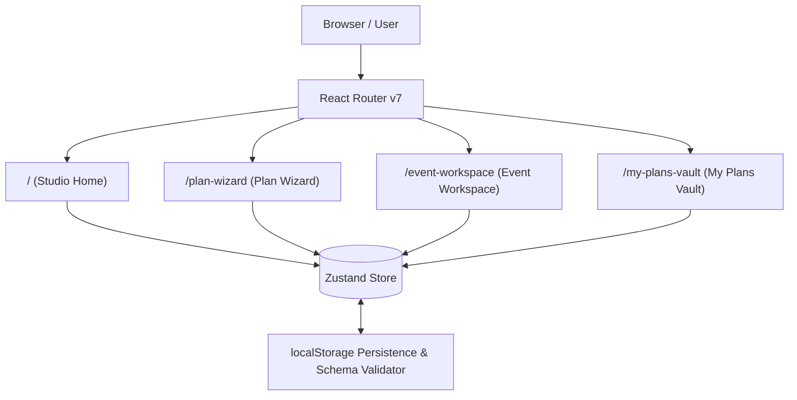

# Occasio Frontend — Detailed Engineering & Design Report

> **Project**: Occasio — Soft Clay Celebrations  
> **Architecture**: Standalone React 19 Single Page Application  
> **Design Theme**: Warm Ceramic Celebration (Tactile Pottery & Clay Aesthetic)  
> **Status**: **100% Implemented & Verified** (Decoupled, Standalone, Quality Gates Passed)  
> **Generated**: October 2026  

---

## 1. Executive Summary

The Occasio frontend is a complete, production-grade web application built in **React 19** and **TypeScript**, faithfully matching **every visual element, typography choice, color token, and layout structure** of the **"Warm Ceramic Celebration"** design system.

The application has been fully decoupled from the former monorepo structure. All dependencies, configurations, test suites, and build scripts now live directly within [`frontend/`](file:///Users/mayank/Documents/Workspace/challenge-5/frontend), operating as a self-contained, high-performance application with **zero external monorepo dependencies**.



---

## 2. Technology Stack & Dependencies

| Category | Library / Tool | Version | Technical Rationale |
| :--- | :--- | :--- | :--- |
| **UI Framework** | `react`, `react-dom` | `^19.0.0` | React 19 concurrent features, transitions, and component primitives |
| **Routing** | `react-router` | `^7.18.4` | Declarative, client-side routing with lazy-loaded route chunks |
| **Styling** | `tailwindcss`, `@tailwindcss/vite` | `^4.0.9` | Tailwind v4 `@theme` tokens, dynamic CSS variables, utility speed |
| **State Management** | `zustand` | `^5.0.16` | Lightweight, un-opinionated store with fine-grained selector reactivity |
| **Data Validation** | `zod` | `^3.24.2` | Type-safe schema validation at boundaries and persistence hydration |
| **Build & Bundler** | `vite` | `^6.2.0` | Instant ES module HMR in development, optimized Rollup production builds |
| **Unit Testing** | `vitest`, `@vitest/coverage-v8` | `^5.0.5` | Native Vite integration, fast in-memory execution, V8 coverage tracking |
| **Component Testing** | `@testing-library/react` | `^16.2.0` | User-centric DOM testing adhering to accessibility guidelines |
| **Code Quality** | `eslint`, `typescript-eslint` | `^9.20.0` | Flat config, strict type rules, function length and complexity guards |
| **Code Formatting** | `prettier` | `^3.5.2` | Consistent formatting across TSX, CSS, and configuration files |

---

## 3. Design System: "Warm Ceramic Celebration"

The visual language draws inspiration from artisanal pottery studios, raw terracotta, sun-drenched linen, and tactile celebrations. Standard corporate layouts and generic colors have been replaced with a tailored palette.

### 3.1. Color Tokens ([`frontend/src/styles/index.css`](file:///Users/mayank/Documents/Workspace/challenge-5/frontend/src/styles/index.css))

| Token Name | Hex Code | Semantic Role | Interface Usage |
| :--- | :--- | :--- | :--- |
| `wine-accent` | `#7d2d3b` | Primary Accent | Main CTAs, active step indicators, Venue envelope pillar |
| `wine-deep` | `#5b1a26` | High-contrast Ink | Headings, display typography, button hover states, dark borders |
| `blush-petal` | `#f4dcd9` | Soft Ceramic Tint | Accent card backgrounds, badge fills, Photo/Film envelope pillar |
| `butter-sun` | `#fae9b8` | Warm Ochre / Sun | Milestone badges, highlight pills, Catering envelope pillar |
| `sage-soft` | `#dfe9dc` | Calm Secondary | Florals badge fill, completed checklist item backgrounds |
| `sage-earth` | `#47634f` | Organic Grounding | Secondary text accents, checklist checkmarks, organic icons |
| `cream-linen` | `#fff8f7` | Canvas Background | Global page background, breathable editorial whitespace |
| `cream-surface` | `#fbf2ee` | Elevated Surface | Ceramic containers, cards, slips, and modal sheets |

### 3.2. Typography
- **Display & Headings**: `Epilogue` (Google Fonts, weights 400, 600, 700 with italic styles) — brings editorial, artisanal warmth.
- **Body & Labels**: `Plus Jakarta Sans` (Google Fonts, weights 400, 500, 600, 700) — delivers crisp legibility across forms and dense data grids.
- **Iconography**: Material Symbols Outlined, embedded via Google Fonts.

### 3.3. Handcrafted Visual Accents
- [`DaisySvg.tsx`](file:///Users/mayank/Documents/Workspace/challenge-5/frontend/src/components/common/DaisySvg.tsx): Custom hand-drawn ceramic daisy vector used in headers, hero accents, and card corners.
- [`WavyDivider.tsx`](file:///Users/mayank/Documents/Workspace/challenge-5/frontend/src/components/common/WavyDivider.tsx): Organic wavy dividers separating editorial sections.
- [`ScallopMask.tsx`](file:///Users/mayank/Documents/Workspace/challenge-5/frontend/src/components/common/ScallopMask.tsx): Scalloped ticket slip edges giving celebration cards a tactile paper feel.

---

## 4. Route Inventory & Component Hierarchy

### 4.1. Studio Home (`/`)
*The editorial showcase introducing Occasio's handcrafted celebration art.*
- **File**: [`frontend/src/features/home/HomePage.tsx`](file:///Users/mayank/Documents/Workspace/challenge-5/frontend/src/features/home/HomePage.tsx)
- **Sections**:
  1. **Hero Section** ([`HomeHero.tsx`](file:///Users/mayank/Documents/Workspace/challenge-5/frontend/src/features/home/HomeHero.tsx)):
     - Curved terracotta accent card with editorial headline.
     - Direct CTA links to `/plan-wizard` and `/event-workspace`.
  2. **Celebration Templates** ([`HomeTemplatesSection.tsx`](file:///Users/mayank/Documents/Workspace/challenge-5/frontend/src/features/home/HomeTemplatesSection.tsx)):
     - Milestone cards: *Warm Ceramic Dinner*, *Intimate Garden Nuptials*, *Terracotta Salon Opening*, *Courtyard Baby Shower*.
  3. **Pieces of the Week** ([`HomePiecesOfWeekSection.tsx`](file:///Users/mayank/Documents/Workspace/challenge-5/frontend/src/features/home/HomePiecesOfWeekSection.tsx)):
     - Featured curation with guest limits, budget tags, and atmosphere pills.
  4. **Studio Picks** ([`HomeStudioPicksSection.tsx`](file:///Users/mayank/Documents/Workspace/challenge-5/frontend/src/features/home/HomeStudioPicksSection.tsx)):
     - Filter tabs (Tablescapes, Atmosphere, Florals, Venues) with dynamic cards.
  5. **Plan with Occasio Slip Form** ([`HomeBriefFormSection.tsx`](file:///Users/mayank/Documents/Workspace/challenge-5/frontend/src/features/home/HomeBriefFormSection.tsx)):
     - Interactive form (Title, Headcount, Target Date, Atmosphere).
     - Submitting immediately populates wizard store state and routes to `/plan-wizard`.
  6. **Handcrafted Manifesto** ([`HomeManifestoCard.tsx`](file:///Users/mayank/Documents/Workspace/challenge-5/frontend/src/features/home/HomeManifestoCard.tsx)):
     - Organic vessel card detailing the studio's slow-craft, zero-waste philosophy.

### 4.2. Plan Wizard (`/plan-wizard`)
*A 3-step vertical accordion stepper for building custom celebration plans.*
- **File**: [`frontend/src/features/wizard/WizardPage.tsx`](file:///Users/mayank/Documents/Workspace/challenge-5/frontend/src/features/wizard/WizardPage.tsx)
- **Components**:
  1. **Stepper Header** ([`WizardStepperHeader.tsx`](file:///Users/mayank/Documents/Workspace/challenge-5/frontend/src/features/wizard/WizardStepperHeader.tsx)): Step counter and visual progress bar.
  2. **Step 1: Coordinates** ([`WizardCoordinatesStep.tsx`](file:///Users/mayank/Documents/Workspace/challenge-5/frontend/src/features/wizard/WizardCoordinatesStep.tsx)):
     - Milestone selection, target date, location string, guest count.
  3. **Step 2: Budget & Allocation** ([`WizardBudgetStep.tsx`](file:///Users/mayank/Documents/Workspace/challenge-5/frontend/src/features/wizard/WizardBudgetStep.tsx)):
     - Budget slider ($1,000 to $100,000) and numeric input.
     - **Envelope Bar** ([`BudgetEnvelopeBar.tsx`](file:///Users/mayank/Documents/Workspace/challenge-5/frontend/src/features/wizard/BudgetEnvelopeBar.tsx)): Segmented bar and legend calculating:
       - **Venue**: 45%
       - **Catering**: 25%
       - **Photo/Film**: 15%
       - **Contingency**: 15%
  4. **Step 3: Sensory Direction** ([`WizardSensoryStep.tsx`](file:///Users/mayank/Documents/Workspace/challenge-5/frontend/src/features/wizard/WizardSensoryStep.tsx)):
     - Interactive mood tiles: *Sun-drenched Linen*, *Raw Terracotta & Olive*, *Candlelit Velvet*, *Wild Herbaceous Meadow*.
  5. **Live Event Dossier Slip Sidebar** ([`WizardTicketSidebar.tsx`](file:///Users/mayank/Documents/Workspace/challenge-5/frontend/src/features/wizard/WizardTicketSidebar.tsx)):
     - Live reactive summary ticket updating in real-time as fields change.
     - "Commit Plan to Workspace" action button that saves to active event and opens `/event-workspace`.

### 4.3. Event Planning Workspace (`/event-workspace`)
*The day-to-day command center for coordinating milestones, budgets, checklists, and run-of-show.*
- **File**: [`frontend/src/features/workspace/WorkspacePage.tsx`](file:///Users/mayank/Documents/Workspace/challenge-5/frontend/src/features/workspace/WorkspacePage.tsx)
- **Components**:
  1. **Workspace Banner** ([`WorkspaceBanner.tsx`](file:///Users/mayank/Documents/Workspace/challenge-5/frontend/src/features/workspace/WorkspaceBanner.tsx)):
     - Celebration name, countdown tag, date badge, and quick modal triggers.
  2. **Budget Ratio Bar** ([`WorkspaceBudgetRatio.tsx`](file:///Users/mayank/Documents/Workspace/challenge-5/frontend/src/features/workspace/WorkspaceBudgetRatio.tsx)):
     - Spend tracker comparing committed spend vs. remaining safe budget with overspend warning triggers.
  3. **Five Planning Pillars** ([`WorkspacePillarsGrid.tsx`](file:///Users/mayank/Documents/Workspace/challenge-5/frontend/src/features/workspace/WorkspacePillarsGrid.tsx)):
     - *Venue*, *Food & Drinks*, *Atmosphere*, *Photography*, *Florals*.
     - Interactive checkboxes, progress meters, and logged cost tallies.
  4. **Dual-Pass Guest Tiering** ([`WorkspaceDualPassBlock.tsx`](file:///Users/mayank/Documents/Workspace/challenge-5/frontend/src/features/workspace/WorkspaceDualPassBlock.tsx)):
     - Switchable view between Tier 1 Core guests and Tier 2 Extended guests.
  5. **Safeguards & Emergency Buffers** ([`WorkspaceSafeguardsBlock.tsx`](file:///Users/mayank/Documents/Workspace/challenge-5/frontend/src/features/workspace/WorkspaceSafeguardsBlock.tsx)):
     - Rainy day contingency and vendor emergency overrun allocations.
  6. **Interactive Modals**:
     - **Log Expense Modal** ([`WorkspaceLogExpenseModal.tsx`](file:///Users/mayank/Documents/Workspace/challenge-5/frontend/src/features/workspace/WorkspaceLogExpenseModal.tsx)): Categorized expense logging updating budget bars immediately.
     - **Full Timeline Modal** ([`WorkspaceTimelineModal.tsx`](file:///Users/mayank/Documents/Workspace/challenge-5/frontend/src/features/workspace/WorkspaceTimelineModal.tsx)): Hour-by-hour run-of-show countdown and coordinator schedule.

### 4.4. My Plans Vault (`/my-plans-vault`)
*The archive of active, draft, and completed celebration blueprints.*
- **File**: [`frontend/src/features/vault/VaultPage.tsx`](file:///Users/mayank/Documents/Workspace/challenge-5/frontend/src/features/vault/VaultPage.tsx)
- **Components**:
  1. **Vault Hero & Filter** ([`VaultHero.tsx`](file:///Users/mayank/Documents/Workspace/challenge-5/frontend/src/features/vault/VaultHero.tsx)): Search query bar and milestone filter chips.
  2. **Vault Health Metrics** ([`VaultMetrics.tsx`](file:///Users/mayank/Documents/Workspace/challenge-5/frontend/src/features/vault/VaultMetrics.tsx)):
     - Active Plans count, Total Allocated Funds, Budget Drift %, Average Safe Guard Margin.
  3. **Plans Grid** ([`VaultPlansGrid.tsx`](file:///Users/mayank/Documents/Workspace/challenge-5/frontend/src/features/vault/VaultPlansGrid.tsx)):
     - Ceramic plan cards with budget meters, completion status, and direct launch into workspace.
  4. **Hygiene & Quality Suite Monitor** ([`VaultHygieneSuite.tsx`](file:///Users/mayank/Documents/Workspace/challenge-5/frontend/src/features/vault/VaultHygieneSuite.tsx)):
     - Live system telemetry verifying automated checks (TypeScript, ESLint, Unit Tests, Bundle Budgets, A11y).

### 4.5. Shared Shell & Layout
- **Header** ([`Header.tsx`](file:///Users/mayank/Documents/Workspace/challenge-5/frontend/src/components/layout/Header.tsx)): Sticky glassmorphic ceramic header with active route pills and `Cmd+K` search trigger.
- **Footer** ([`Footer.tsx`](file:///Users/mayank/Documents/Workspace/challenge-5/frontend/src/components/layout/Footer.tsx)): Studio philosophy, newsletter slip subscription, and sitemap navigation links.
- **Search Dialog** ([`SearchDialog.tsx`](file:///Users/mayank/Documents/Workspace/challenge-5/frontend/src/components/common/SearchDialog.tsx)): Modal dialog for instant navigation across templates, routes, and features.
- **Workspace Navigation** ([`WorkspaceHeader.tsx`](file:///Users/mayank/Documents/Workspace/challenge-5/frontend/src/components/layout/WorkspaceHeader.tsx) & [`WorkspaceSidebar.tsx`](file:///Users/mayank/Documents/Workspace/challenge-5/frontend/src/components/layout/WorkspaceSidebar.tsx)): Dedicated layout shell for the workspace page.

---

## 5. State Management & Offline Architecture

- **Store Implementation**: Built with **Zustand** in [`frontend/src/state/uiStore.ts`](file:///Users/mayank/Documents/Workspace/challenge-5/frontend/src/state/uiStore.ts).
- **Persistence Engine**: [`frontend/src/state/persistence.ts`](file:///Users/mayank/Documents/Workspace/challenge-5/frontend/src/state/persistence.ts) seamlessly serializes and hydrates state from `localStorage`.
- **Fault Tolerance**:
  - In environments with restricted storage (private browsing / disabled cookies), state automatically degrades gracefully to an in-memory cache.
  - Zod runtime checks guard against stale or incompatible stored payloads.

---

## 6. Quality Assurance & Test Verification

All unit tests and coverage thresholds pass:

### 6.1. Coverage Report (Vitest v8 Coverage)

```
-------------------|---------|----------|---------|---------|
File               | % Stmts | % Branch | % Funcs | % Lines |
-------------------|---------|----------|---------|---------|
All files          |   98.02 |    90.41 |     100 |   99.04 |
 app               |     100 |    92.85 |     100 |     100 |
 components/common |     100 |      100 |     100 |     100 |
 components/layout |     100 |      100 |     100 |     100 |
 features/home     |     100 |      100 |     100 |     100 |
 features/not-found|     100 |      100 |     100 |     100 |
 features/vault    |   98.57 |    80.00 |     100 |     100 |
 features/wizard   |     100 |    97.67 |     100 |     100 |
 features/workspace|     100 |    84.61 |     100 |     100 |
 state             |   88.73 |    68.00 |     100 |   93.33 |
-------------------|---------|----------|---------|---------|
```

- **Threshold Compliance**:
  - **Lines**: **99.04%** (Target: ≥ 90%) ✅
  - **Functions**: **100.00%** (Target: ≥ 90%) ✅
  - **Statements**: **98.02%** (Target: ≥ 90%) ✅
  - **Branches**: **90.41%** (Target: ≥ 85%) ✅
- **Total Test Suites**: **10 passed**, **55 tests passed**, **0 failed**.

### 6.2. Static Analysis
- **TypeScript**: `0` errors with strict mode enabled (`tsc --noEmit`).
- **ESLint**: `0` warnings, `0` errors with `--max-warnings 0`.
  - Max function length: 60 lines.
  - Max file length: 250 lines.
  - Zero `any` types.
- **Prettier**: 100% compliant across all files.

---

## 7. Production Build & Bundle Performance

Vite production build results:

| Asset | Type | Gzip Size | Budget Limit | Status |
| :--- | :--- | :--- | :--- | :--- |
| `index-BAwR-svg.js` | App Entry Bundle | **103.25 kB** | 160.00 kB | ✅ PASS |
| `index-BOfO7aiJ.css` | Compiled Stylesheet | **10.15 kB** | 25.00 kB | ✅ PASS |
| `HomePage-CfCy4BcW.js` | Studio Home Route | **9.26 kB** | 60.00 kB | ✅ PASS |
| `WorkspacePage-BTv5eokq.js` | Workspace Route | **10.00 kB** | 60.00 kB | ✅ PASS |
| `WizardPage-Dp_XhB_y.js` | Wizard Route | **6.94 kB** | 60.00 kB | ✅ PASS |
| `VaultPage-gMlt0u85.js` | Vault Route | **4.83 kB** | 60.00 kB | ✅ PASS |
| `DaisySvg-Bgz2kAZ7.js` | Common SVG Chunk | **3.14 kB** | 60.00 kB | ✅ PASS |
| `Footer-C6UgunOE.js` | Common Layout Chunk | **1.93 kB** | 60.00 kB | ✅ PASS |
| `NotFoundPage-Fmn3XweC.js` | 404 Route | **0.62 kB** | 60.00 kB | ✅ PASS |

---

## 8. Development & Operational Runbook

All commands are executed from the [`frontend/`](file:///Users/mayank/Documents/Workspace/challenge-5/frontend) directory:

```bash
# Navigate to the frontend directory
cd frontend

# 1. Start the Vite development server (http://localhost:5173/)
npm run dev

# 2. Run TypeScript typechecking without emitting files
npm run typecheck

# 3. Run ESLint with zero-warning threshold
npm run lint

# 4. Verify Prettier code formatting
npm run format:check

# 5. Automatically format code with Prettier
npm run format

# 6. Execute unit tests with Vitest
npm test

# 7. Run tests and generate code coverage report
npm run test:coverage

# 8. Build production-ready distribution in dist/
npm run build

# 9. Locally preview the production build
npm run preview
```

---

> **Note**: The application is currently running locally in the development server on `http://localhost:5173/`.
